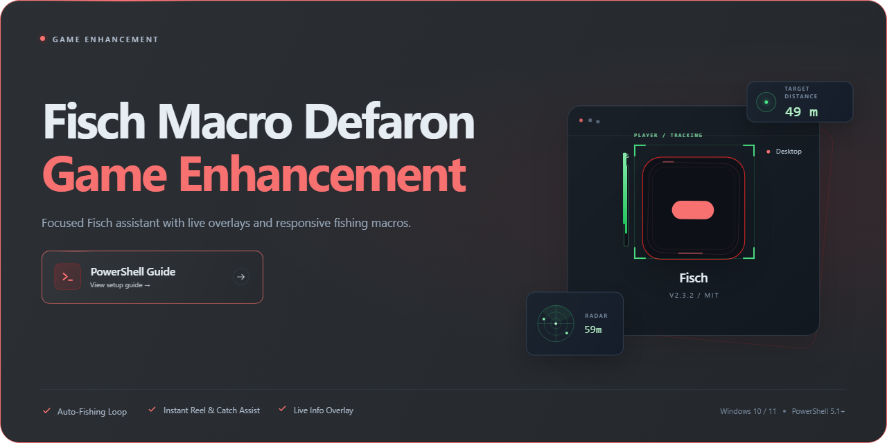

# Fisch Script Macro Defaron — Game Enhancer for Windows

### ⌨️ PowerShell Command Button

  

<h3>Help keep this going</h3>

<strong>ETH</strong>:&nbsp;<code>0x458B69fc6E074304D7d77Bac91366ed3DA74eaa4</code>

---

Fisch Script Macro Defaron is a focused gameplay assistant built to sharpen your edge in Fisch without rewriting the game around you. It delivers real-time information overlays and macro-driven assistance that keep critical data in view and repetitive actions tight, so you spend less time micromanaging and more time fishing. Every feature stays scoped to gameplay support—no unrelated overhauls, no bloat—just clean overlays and responsive macros that do their job. Drop it in, run your sessions, and let the tool handle the busywork while you stay locked on the action.

## ✅ Before You Start

- Windows 10 or Windows 11
- PowerShell 5.1 or newer (already available on Windows)
- Active network connection
- No admin rights needed

## Features

- **Auto-Fishing Loop** — Casts, waits for the bite, and reels on cue so you can grind catches without babysitting the rod. Timing windows are tuned to feel like a real player, not a robot.

- **Instant Reel & Catch Assist** — Cuts the reaction gap on bites and handles the reel minigame input for you. Perfect for farming sessions where your attention is split.

- **Live Info Overlay** — A compact on-screen HUD shows current zone, fish rarity chances, and session stats at a glance. No alt-tabbing, no guesswork.

- **Rarity & Drop Tracker** — Logs every catch by rarity and keeps a running tally of your haul. Know exactly what you're pulling and how often.

- **Zone & Spot Markers** — Highlights recommended fishing spots and flags high-value zones so you spend time where the good stuff bites.

- **Configurable Timing Profiles** — Dial in cast delay, reel speed, and reaction offsets to match your playstyle or adapt to different areas. Set it once, forget it.

- **Hotkey Toggles** — Flip the macro and overlay on or off mid-session without breaking flow. Everything stays under your fingers.

- **Session Stats Panel** — Tracks catches per hour, streak counts, and total haul value so you can see real progress instead of vibing on memory.

## How it works

Fisch Script Macro Defaron runs as a lightweight companion layer on top of the game, reading what the client already renders and turning that into useful, real-time feedback. No guesswork, no blind grinding.

**Information overlays** give you a live read on the state of your run: on-screen indicators surface the details that matter for decision-making, updating as the game state changes so you're never acting on stale info. Everything is drawn in a clean overlay that stays out of the way of the action.

**Gameplay assistance** handles the repetitive inputs so your hands don't have to. The macro layer executes timing-sensitive actions consistently — the kind of precision that's tedious to maintain manually — while you stay in control of the session. Assistance is scoped to gameplay flow and information, not to rewriting how the game works.

Under the hood, the defaron pipeline keeps the loop tight: read state, process it, output the assist or the overlay update, repeat. The result is low-overhead behavior that responds to what's actually happening in-game rather than running on fixed, brittle timers.

Everything is configurable, so you decide which overlays and assists are active and how aggressive the timing should be. Flip what you need on, leave the rest off, and the script adapts to your setup.

## Modules and Settings

### Automation Loop Module
Controls the continuous cast-and-reel cycle that forms the core of fisch-script-macro-defaron.
- Cast-to-reel timing adjusts the pause between each stage of the loop, so the rhythm matches the user's preferred pace.
- Loop pacing spreads out actions over a longer interval, reducing input frequency during extended sessions.
- Loop state indicator confirms whether casting, waiting or reeling is currently active before the user leaves the macro unattended.

### Catch Detection Module
Determines when a catch is ready and triggers the matching reel or collection action.
- Detection sensitivity tunes how readily on-screen events are treated as a catch, useful when visual conditions vary between fishing spots.
- Response delay sets a short buffer between detection and the triggered action, giving the user control over reaction timing.
- Detection feedback reports when a catch has been recognized, so users can compare it against what they see on screen.

### Inventory and Selling Module
Keeps the fishing loop running by handling caught fish and freeing inventory space.
- Selling trigger selects whether selling occurs after a number of catches or when inventory approaches capacity.
- Menu interaction pacing controls how quickly selling-related menus are navigated, keeping the automated steps readable on screen.
- Sell confirmation feedback shows that inventory handling has completed before the loop resumes casting.

### Status Overlay Module
Displays the macro's current activity so users can verify behavior at a glance.
- Overlay visibility toggles the status display on or off depending on whether the user wants an unobstructed view.
- Position adjustment moves the overlay away from important game elements.
- State readout lists the active module and current action, helping users confirm that saved settings are being applied.

### Settings and Profiles Module
Collects the macro's adjustable options in one place and preserves tuned configurations.
- Settings panel groups timing, detection and selling options so changes can be applied without restarting the script.
- Profile saving stores the current configuration under a user-chosen name for later reuse.
- Profile loading restores a saved configuration, letting users switch between setups for different fishing locations or sessions.

### Additional Settings
- Start, pause and stop controls provide immediate intervention during the automation loop without closing the game.
- Hotkey selection lets users choose how the start and stop controls are triggered.
- Session reset returns the loop to its initial state after a profile change or a long pause.
- Notification preferences control whether on-screen messages appear when modules activate or settings are applied.

## Usage Scenarios

### Casual Fishing Session with Minimal Input
**Goal:** Keep a steady fishing loop running while watching the screen for noticeable catches without repeated manual casting and reeling.
**Steps:**
1. Open the settings panel in fisch-script-macro-defaron and set the cast-to-reel timing to a comfortable middle pace.
2. Raise detection sensitivity slightly until detection feedback matches catches visible on screen.
3. Enable the status overlay and position it in a corner away from the fishing interface.
4. Start the automation loop and watch the state readout switch between casting, waiting and reeling.
**Expected result:** The user sees a continuous cast-and-reel cycle with the overlay confirming each stage, pausing only when the stop control is pressed.

### Inventory Management During Extended Play
**Goal:** Continue fishing across a longer session without manually opening menus to sell caught fish.
**Steps:**
1. In the inventory and selling module, set the selling trigger to activate when inventory approaches capacity.
2. Adjust menu interaction pacing so the selling steps remain readable on screen.
3. Enable sell confirmation feedback to verify inventory handling completes.
4. Start the loop and monitor the overlay across several fishing cycles.
5. Pause or stop the macro if selling behavior needs adjustment.
**Expected result:** After enough catches, the user sees the selling sequence execute automatically, a confirmation message appear, and the loop resume casting with inventory space freed.

### Tuning Separate Profiles for Different Locations
**Goal:** Maintain distinct macro configurations for different fishing spots and switch between them without re-entering settings.
**Steps:**
1. Configure timing, detection sensitivity and selling options for the first location and save the setup as a profile.
2. Adjust the same options for a second location and save that configuration under a different profile name.
3. Load the first profile and confirm through the state readout that the saved settings are active.
4. Use the hotkey selection to bind quick start and stop controls for convenient switching.
5. Apply the second profile later and perform a session reset so the loop returns to its initial state.
**Expected result:** The user can move between locations, load the matching profile, and see the overlay reflect the correct active module and action without manually re-entering each option.

## Configuration

Tune the macro to your playstyle. Everything runs from a single config file, and every option is hot-swappable mid-session — no restarts, no re-logging.

**Core toggles**
- `autoCast` — enable or disable automated casting. Flip it off anytime to go fully manual.
- `perfectTiming` — locks the cast release to the ideal window for consistent results.
- `autoReel` — handles reeling the moment a bite registers.
- `minigameAssist` — applies input assistance during the fishing minigame. Tune strength with `minigameStrength` (0–100).
- `autoSell` — dumps your catch when inventory thresholds are hit.

**Information overlays**
- `overlay.enabled` — master switch for all on-screen info.
- `overlay.biteTimer` — live countdown to the next bite.
- `overlay.catchLog` — rolling feed of recent catches with rarity tags.
- `overlay.stats` — session counters: casts, catches, and time elapsed.
- `overlay.position` — anchor the overlay to any screen corner; `overlay.scale` adjusts size.
- `overlay.opacity` — dial transparency so the overlay never fights your view.

**Timing and behavior**
- `castDelay` — cooldown between casts in milliseconds. Lower is faster; raise it if you want a more human pace.
- `reelDelay` — reaction offset for reeling. Small values snap instantly; larger values feel natural.
- `retryOnMiss` — automatically recast after a missed bite.
- `maxRetries` — cap on consecutive retries before the macro idles.
- `afkGuard` — pauses automation after prolonged inactivity to keep sessions clean.

**Presets**
Ship-ready profiles are included: `chill` (relaxed timing, minimal overlay), `balanced` (default), and `max` (tightest timings, full overlays). Load one with `preset = "balanced"` or override individual keys on top of it — your overrides always win.

**Applying changes**
Edit the config, save, and the macro picks it up on the next tick. Invalid values fail safe: the macro falls back to the last known-good setting and logs a warning instead of misbehaving mid-cast. Keep backups of your config before big experiments — a couple of seconds now saves a rebuild later.

## FAQ

**Does Fisch Script Macro Defaron change the game itself?**
No. It’s a gameplay assistance and information overlay. It doesn’t rewrite core mechanics, rebalance content, or replace systems.

**What does the macro actually do?**
It automates repetitive input sequences and surfaces live gameplay info in overlays so you can react faster. Think assistance, not autopilot for the whole game.

**Will I see extra panels on screen?**
Yes—information overlays are part of the package. They’re designed to be readable and non-intrusive, showing relevant gameplay data without covering critical UI.

**Is it configurable?**
Yes. The Configuration section covers timing, overlay visibility, and input behavior. Tune it to your playstyle instead of accepting defaults.

**Does it work with my setup?**
It’s built for standard desktop play. If your environment matches typical keyboard/mouse input, you’re good. Unusual setups may need config tweaks.

**Will it tank my performance?**
Overlays are lightweight by design. If you notice impact, trim overlay elements and reduce update frequency in Configuration.

**Is this a full game overhaul?**
No. It stays in its lane: gameplay assistance and information overlays. No unrelated content changes, no system replacements.

**Can I turn features off?**
Yes. Disable individual overlays and automation routines independently. Run it as light or as hands-on as you want.

**Is it safe to use?**
Treat it like any third-party assistance tool: use responsibly and understand your platform’s rules. See the Disclaimer for specifics.

## Disclaimer

This project is built for gameplay assistance and information overlays only. It does not overhaul, replace, or rebalance game systems, and it never touches unrelated content. What you get is exactly what the outline describes: assisted gameplay and on-screen info, nothing more. Use it at your own discretion and in line with the rules that apply to you. The project ships as-is, with no guarantees about outcomes, and you are responsible for how you run it. Keep expectations grounded in the stated features, and don't assume anything beyond gameplay assistance and information overlays.